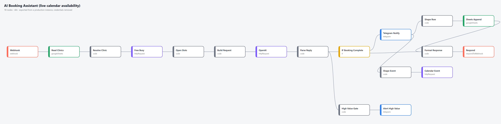
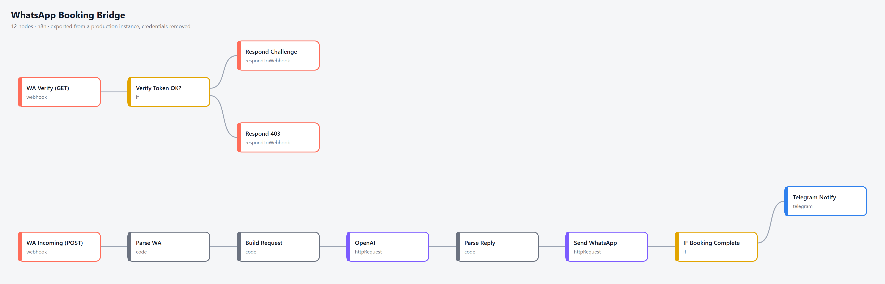
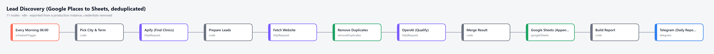

# n8n workflows I built and ran in production

Five workflows exported from my own n8n instance, where they ran for my booking-assistant project
(a demo dental clinic) and my lead pipeline. Credentials, IDs and personal data are removed;
the logic is unchanged. Each file imports straight into n8n and has an **Overview** note
telling you what to plug in.

| # | Workflow | What it does | Nodes |
|---|---|---|---|
| 1 | [AI Booking Assistant](akislar/1-ai-booking-assistant.json) | Chat endpoint that checks **real** Google Calendar free/busy before offering a time, then books it in Sheets + Calendar and alerts Telegram (separate alert for high-value treatments). | 18 |
| 2 | [WhatsApp Booking Bridge](akislar/2-whatsapp-booking-bridge.json) | WhatsApp Cloud API webhook (verification + messages) running the same booking conversation and replying on WhatsApp. | 12 |
| 3 | [Appointment Reminders](akislar/3-appointment-reminders.json) | Hourly job: looks 24-25h ahead in each business's calendar, so every appointment is reminded exactly once (duplicate ledger), in the business's own time zone. | 6 |
| 4 | [Customer Reactivation](akislar/4-customer-reactivation.json) | Finds dormant customers, drafts a short personal win-back message for each with AI, saves drafts for human review. | 8 |
| 5 | [Lead Discovery](akislar/5-lead-discovery.json) | Daily city/term rotation → Google Maps via Apify → junk and duplicate filter → reads each website → AI scores the lead and says honestly whether the gap was verified → Sheets + Telegram report. | 11 |

## Things I care about in these builds

- **No invented availability.** The booking assistant only offers slots it just read from the calendar.
- **Honest AI output.** The lead scorer has to say whether it actually read the weakness on the website;
  "could not verify" is a valid answer and caps the score.
- **Cheap before expensive.** Junk, duplicates and obviously unfit leads are dropped before any paid AI call.
- **Someone always knows.** Every workflow ends in a Telegram message, so failures and results are visible.

## Import

n8n → Workflows → Import from file → pick a JSON → open the **Overview** note → replace the `YOUR_...`
placeholders and attach your own credentials.

Built by Kerem Aydın, freelance automation developer (n8n, Node.js, Next.js).
